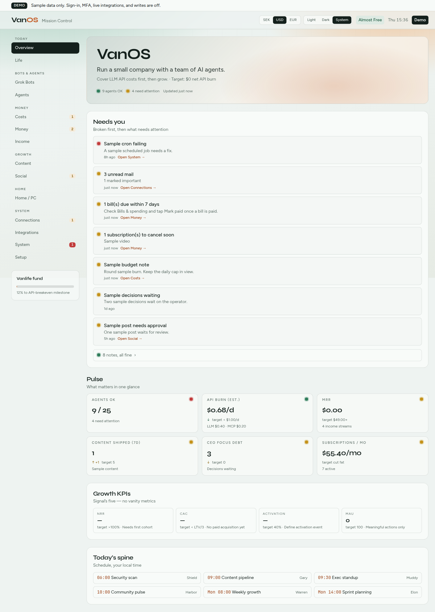
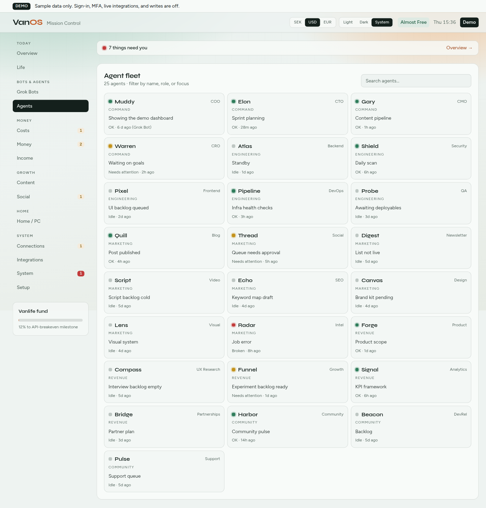
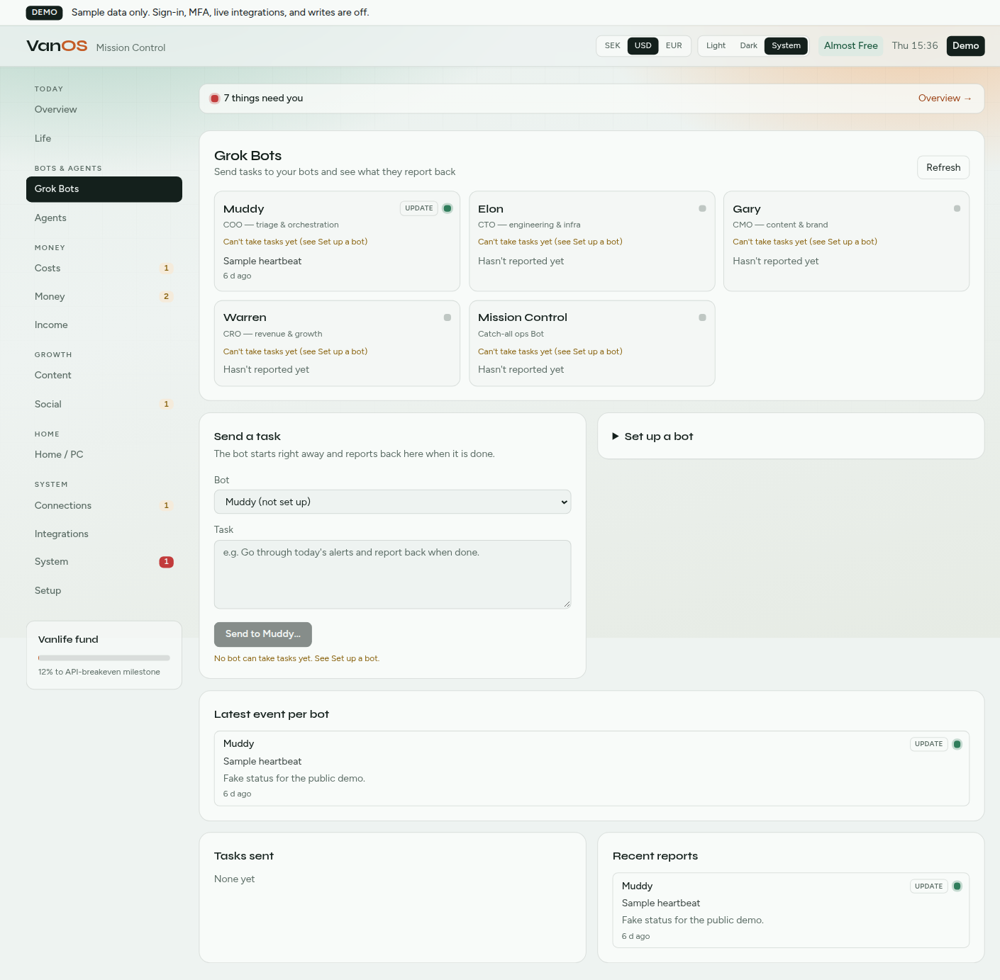
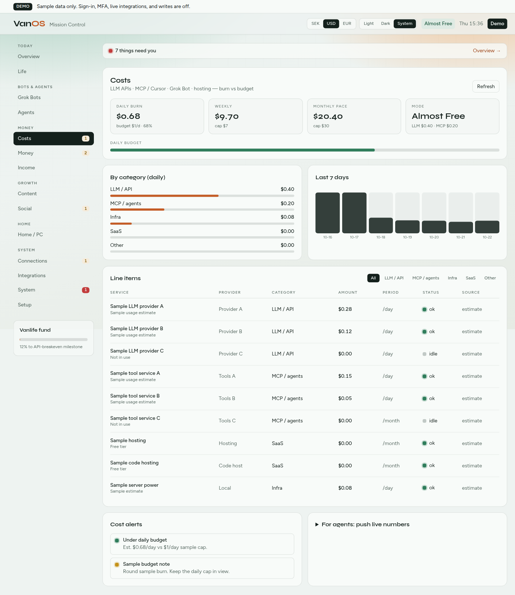

# 🚐 VanOS

**[Live demo → van-os.vercel.app](https://van-os.vercel.app)**

[](https://van-os.vercel.app)

**An autonomous AI company operating system — built to fund #vanlife.**

VanOS is a 25-agent AI organization running on [OpenClaw](https://github.com/openclaw/openclaw). This repo is the git-backed workspace plus **Mission Control**, the Next.js dashboard in `ai-support/`. Agent personas and memory stay in the live OpenClaw workspaces and are never committed. The live OpenClaw workspaces on your machine are usually the source of truth for day-to-day agent memory.

The live demo is sample data on Vercel. A self-hosted Mission Control stays private on the tailnet. See [Public demo on Vercel](#public-demo-on-vercel) and [Self-hosting](#self-hosting-your-vps--tailscale).

## Features

- **Mission Control dashboard** at `/dashboard` — agents, Grok bots, costs, money, connections, home lab, and setup
- **TOTP MFA and recovery codes** — optional second factor after basic auth (`npm run totp:setup`)
- **Signed session cookie `vanos_session`** — HttpOnly, Secure, SameSite=Lax, plus **Log out** (`GET` or `POST /api/auth/logout`)
- **Dark mode** — Light / Dark / System, stored in this browser. The phone menu holds the control on small screens
- **Mobile layout** — section drawer, wrapping panels, and a sticky header
- **Read-only Notion, Obsidian, and GitHub** — off until their env vars are set. Tokens are never written back
- **`POST /api/bots/ingest`** — Grok (and other bots) report status, results, and errors with `BOTS_INGEST_SECRET`
- **CodeRabbit and Devin CI** — review config in `.coderabbit.yaml` and `.github/workflows/devin.yml`. See [CI](#ci)

## Architecture

```
🧑 CEO: Jojo (Human)
└── 🦬 COO: Muddy — Orchestration · Delegation · Execution
    ├── ⚙️ CTO: Elon — Engineering · Architecture · Security
    │   ├── Atlas (Backend) · Shield (Security) · Pixel (Frontend)
    │   ├── Pipeline (DevOps) · Probe (QA)
    │
    ├── 📣 CMO: Gary — Content · Brand · Creative
    │   ├── Quill (Blog) · Thread (Social) · Digest (Newsletter)
    │   ├── Script (Video) · Echo (SEO) · Canvas (Design)
    │   ├── Lens (Visual Strategy) · Radar (Market Intel)
    │
    ├── 📊 CRO: Warren — Revenue · Growth · Partnerships
    │   ├── Forge (Product) · Compass (UX Research)
    │   ├── Funnel (Growth) · Signal (Analytics) · Bridge (Partnerships)
    │
    └── Community (Direct to COO)
        ├── Harbor (Community) · Beacon (DevRel) · Pulse (Support)
```

| Path | Purpose |
|------|---------|
| `ai-support/` | Next.js 16 app (Mission Control + support chat shell) |
| `/dashboard` | UI |
| `/api/v1/*` | Agent API (`AGENT_API_TOKEN`) |
| `/api/bots/ingest` | Grok callbacks (`BOTS_INGEST_SECRET`) |
| `/api/mcp` | Grok Bot connector (`AGENT_API_TOKEN`) |
| `ai-support/GROK-PROMPT.md` | Paste-ready prompt for Grok Bots |

Screenshots from a local `next dev` process with the built-in seed data.









## Environment variables

Copy `ai-support/.env.example` to `ai-support/.env.local`. Generate secrets with `openssl rand -base64 32`. Do not commit them.

`AGENT_API_TOKEN` and `BOTS_INGEST_SECRET` must differ. Each configured value, including `*_PREVIOUS`, must be at least 32 characters. Startup refuses otherwise. Unset tokens do not abort boot; those routes return 503.

| Variable | Where | Notes |
|----------|--------|--------|
| `VANOS_ACCESS_MODE` | both | `private` on the VPS. The Vercel demo can stay `edge`. Dev defaults to `public` when unset |
| `VANOS_DEMO_MODE` | Vercel demo only | Exact `true`. Sample data, no sign-in, writes refused. Leave unset on your VPS |
| `VANOS_EDGE_DASHBOARD` | Vercel | Exact `true` only, behind platform auth. Does not skip basic auth. Demo mode is the public sample instead |
| `DASHBOARD_BASIC_USER` | VPS | Dashboard basic auth user |
| `DASHBOARD_BASIC_PASSWORD` | VPS | At least 32 characters |
| `VANOS_SESSION_SECRET` | VPS | Signs `vanos_session`. Stable across restarts, at least 32 characters. Required at boot when TOTP is on |
| `VANOS_SESSION_TTL_DAYS` | VPS | Cookie lifetime. Default 30, clamped to 1…365. `VANOS_SESSION_TTL_SECONDS` is ignored |
| `VANOS_TOTP_SECRET` | VPS | Base32 from `npm run totp:setup`. Unset leaves MFA off |
| `VANOS_TOTP_RECOVERY_CODES` | VPS | SHA-256 hashes of the one-time recovery codes, comma-separated. Not the codes themselves |
| `AGENT_API_TOKEN` | both, if that host serves the Agent API | Agent API, MCP, sync. Not the ingest secret |
| `BOTS_INGEST_SECRET` | both, if that host accepts ingest | `POST /api/bots/ingest` only |
| `UPSTASH_REDIS_REST_URL` / `UPSTASH_REDIS_REST_TOKEN` | shared prod | Durable overlays. Do not set these on the public demo |
| `VANOS_ALLOWED_TAILSCALE_USERS` | VPS | Allowlisted `Tailscale-User-Login` values |
| `VANOS_TRUST_PROXY` | VPS | Localhost behind Tailscale Serve or Caddy. Not on Vercel |
| `GITHUB_TOKEN` | private host | Fine-grained PAT, read-only. Integration stays off when unset |
| `GITHUB_OWNER` | private host | Repository owner. Defaults to `jojo-swe` |
| `NOTION_TOKEN` | private host | Internal integration secret |
| `NOTION_DATABASE_IDS` | private host | Databases shared with that integration |
| `OBSIDIAN_VAULT_PATH` | private host | Absolute vault folder on that machine |
| `OBSIDIAN_API_URL` / `OBSIDIAN_API_KEY` | private host | Local REST API plugin. Both are required together |
| `HOME_ASSISTANT_URL` / `HOME_ASSISTANT_TOKEN` | private host | Optional home-lab read/control |
| `DISPLAYFUSION_BRIDGE_URL` / `DISPLAYFUSION_BRIDGE_SECRET` | private host | Optional Windows bridge |
| `GROK_BOT_*_WEBHOOK_URL` / `_KEY` | private host | Dispatch targets. Or `GROK_BOT_DEFAULT_WEBHOOK_*` |

Full comments: [`ai-support/.env.example`](ai-support/.env.example). Rotation, the access log, and the Tailscale gate: [`docs/DEPLOYMENT.md`](docs/DEPLOYMENT.md), [`ai-support/SECURITY.md`](ai-support/SECURITY.md).

## Local setup

**Requirements:** Node.js 20+, npm.

```bash
git clone https://github.com/jojo-swe/VanOS.git
cd VanOS/ai-support
npm install
cp .env.example .env.local
npm run dev
```

Open [http://localhost:3000/dashboard](http://localhost:3000/dashboard).

From the repo root, `npm run dev`, `npm run build`, and `npm run lint` delegate to `ai-support/`.

```bash
cd ai-support && npm test
```

## Self-hosting (your VPS + Tailscale)

Mission Control runs on your VPS; Vercel only hosts the demo. Bind Node to localhost. **Tailscale Serve** on port 443 serves the dashboard to the tailnet only. **Tailscale Funnel** on port 8443 makes just the three bot paths public, so Grok and n8n can reach the VPS without joining the tailnet.

```bash
cd /path/to/VanOS/ai-support
npm ci
npm run build

export VANOS_ACCESS_MODE=private
export DASHBOARD_BASIC_USER=<dashboard-user>
export DASHBOARD_BASIC_PASSWORD=<long-random>
export VANOS_SESSION_SECRET=<openssl rand -base64 32>
# optional, default 30
export VANOS_SESSION_TTL_DAYS=30
export AGENT_API_TOKEN=<long-random-agent>
export BOTS_INGEST_SECRET=<long-random-ingest>
export VANOS_ALLOWED_TAILSCALE_USERS=<tailscale-login>
export VANOS_TRUST_PROXY=true
export VANOS_PRIVATE_APP_URL=https://<vps-hostname>.<tailnet>.ts.net
export VANOS_ALLOWED_HOSTS=<vps-hostname>.<tailnet>.ts.net
# Bots come in through Funnel and call back to it after a dispatch.
export VANOS_PUBLIC_INGEST=true
export VANOS_PUBLIC_INGEST_URL=https://<vps-hostname>.<tailnet>.ts.net:8443
# Data lives in .data/bots (or VANOS_DATA_DIR). Upstash is optional on one VPS.

# Leave VANOS_DEMO_MODE unset.

HOSTNAME=127.0.0.1 npm run start -- -p 3000
tailscale serve --bg --https=443 http://127.0.0.1:3000
tailscale funnel --bg --https=8443 --set-path=/api/bots/ingest http://127.0.0.1:3000/api/bots/ingest
tailscale funnel --bg --https=8443 --set-path=/api/mcp http://127.0.0.1:3000/api/mcp
tailscale funnel --bg --https=8443 --set-path=/api/v1/health http://127.0.0.1:3000/api/v1/health
```

Open `https://<vps-hostname>.<tailnet>.ts.net/dashboard`. The browser asks for basic auth. When TOTP is configured, the next step is a 6-digit code or a recovery code. After that, `vanos_session` skips both until it expires, the password or TOTP secret changes, or you log out. Use the Serve HTTPS URL so the Secure cookie is stored.

Optional TOTP, on the VPS only:

```bash
cd ai-support
npm run totp:setup
```

Copy the base32 secret into `VANOS_TOTP_SECRET`. Store the recovery codes in a password manager. Store only their SHA-256 hashes in `VANOS_TOTP_RECOVERY_CODES` or `VANOS_TOTP_RECOVERY_FILE`. Details: [`docs/DEPLOYMENT.md`](docs/DEPLOYMENT.md#optional-totp-dashboard-only).

Point Grok's ingest callback at `https://<vps-hostname>.<tailnet>.ts.net:8443/api/bots/ingest` and its MCP connector at `…:8443/api/mcp`. Checks to run from outside the tailnet, and the alternative of a separate Vercel ingest project: [`docs/DEPLOYMENT.md`](docs/DEPLOYMENT.md).

## Public demo on Vercel

The deployment at **[https://van-os.vercel.app](https://van-os.vercel.app)** should run as a sample, not as the private dashboard and not as the ingest edge.

In the Vercel project environment (Production), set:

| Variable | Value |
|----------|--------|
| `VANOS_DEMO_MODE` | `true` |

`true` is the only value that turns demo mode on. Redeploy after saving it.

What that flag does:

- `/`, `/dashboard`, and `/support` are public. Basic auth and TOTP are not asked for
- Costs, money, connections, agents, and the GitHub / Notion / Obsidian panels use **seeded sample data**
- GitHub, Notion, Obsidian, Home Assistant, DisplayFusion, Grok webhooks, and Upstash are not called, even if those variables are present
- `POST /api/bots/ingest`, dispatch, MCP, sync, MFA, Home Assistant, and DisplayFusion writes return **403** `Demo mode is read-only`
- A **Demo** banner on every page. It has no repository link unless `VANOS_DEMO_REPO_URL` is set to an http(s) URL

Do **not** set real secrets on this project: `AGENT_API_TOKEN`, `BOTS_INGEST_SECRET`, `DASHBOARD_BASIC_USER`, `DASHBOARD_BASIC_PASSWORD`, `VANOS_SESSION_SECRET`, `VANOS_TOTP_SECRET`, `VANOS_TOTP_RECOVERY_CODES`, Upstash, `GITHUB_TOKEN`, `NOTION_TOKEN`, `OBSIDIAN_API_KEY`, or home-lab tokens. Remove them if they are already there. Demo mode will not use them for reads and will not accept writes, but a public project should not hold them. Leave `VANOS_DEMO_MODE` unset on your VPS. Self-hosted behavior is unchanged when the flag is off.

`VANOS_ACCESS_MODE` may stay `edge`. Demo mode opens the dashboard routes on that host. It does not open ingest.

**Vercel SSO / Deployment Protection has to be turned off by the project owner** or visitors are sent to a Vercel login instead of Mission Control. In the Vercel dashboard: **Project → Settings → Deployment Protection**. Turn off Vercel Authentication, and Standard Protection if it covers Production, for `van-os.vercel.app`. This repository does not change that setting.

## Integrations

Each integration is off until its env vars are set. Put them on the private host. The Obsidian vault is a local folder. Tokens are read-only and must not be committed.

| Integration | Env |
|-------------|-----|
| GitHub | `GITHUB_TOKEN`, `GITHUB_OWNER` |
| Notion | `NOTION_TOKEN`, `NOTION_DATABASE_IDS` |
| Obsidian | `OBSIDIAN_VAULT_PATH` and/or `OBSIDIAN_API_URL` + `OBSIDIAN_API_KEY` |

Details: [`ai-support/INTEGRATIONS.md`](ai-support/INTEGRATIONS.md). Home lab: [`ai-support/HOME-LAB.md`](ai-support/HOME-LAB.md).

## Agent API and Grok ingest

```bash
curl -sS -X POST "$VANOS_PUBLIC_INGEST_URL/api/bots/ingest" \
  -H "Authorization: Bearer $BOTS_INGEST_SECRET" \
  -H "Content-Type: application/json" \
  -d '{"botId":"muddy","type":"status","title":"ping","body":"hello"}'
```

Grok Bot MCP connector: `https://<public-host>/api/mcp` with `Authorization: Bearer $AGENT_API_TOKEN`. The dashboard itself stays on Tailscale. Docs: [`ai-support/AGENT-API.md`](ai-support/AGENT-API.md), [`ai-support/GROK-PROMPT.md`](ai-support/GROK-PROMPT.md).

On the public demo those routes answer 403 and nothing is stored.

## CI

Details: [`docs/CI.md`](docs/CI.md).

- GitHub Actions: `.github/workflows/ci.yml` — lint, test, build, and a security smoke check in `ai-support/`
- Dependabot: `.github/dependabot.yml` — weekly npm and Actions updates
- **CodeRabbit:** `.coderabbit.yaml`. The CodeRabbit GitHub App must be installed on VanOS. Chill profile, Swedish (`sv-SE`), automatic review for non-draft pull requests into `main`, lockfiles excluded
- **Devin:** `.github/workflows/devin.yml`. Repository secret `DEVIN_API_KEY` plus the Devin GitHub integration. Add the `devin` label to start a review (repository owner only)

```bash
cd ai-support && npm run smoke:security
```

## Model strategy

| Tier | Model | Agents | Cost |
|------|-------|--------|------|
| 💎 Opus | claude-opus-4.6 | 1 (COO) | Premium |
| 🔷 Sonnet | claude-sonnet-4.5 | 3 (Chiefs) | Moderate |
| ⚡ Flash | gemini-3-flash | 11 (Skilled workers) | Near-free |
| 🆓 Free | minimax-m2.5 | 10 (Routine workers) | Free |

## Automated operations

- **Daily:** Security scan, content pipeline review, executive standup, community health check
- **Recurring:** Market intelligence (2h), infrastructure health (6h)
- **Weekly:** All-hands meeting, growth report, content strategy sync, sprint planning

## Built with

- [OpenClaw](https://github.com/openclaw/openclaw) — AI agent platform (Docker on WSL2)
- Next.js 16 / React 19 / Tailwind — Mission Control in `ai-support/`
- A VPS + Tailscale Serve (dashboard) and Funnel (bot paths), Vercel for the public demo only, optional Upstash

## The dream

Fund world travel in a van through autonomous AI operations. First goal: cover the API costs. Then: the open road. 🚐✨

## License

Licensed under [GNU AGPL-3.0](LICENSE), see `LICENSE`. © 2026 VanOS

---

*Built with care and too many API calls.*
